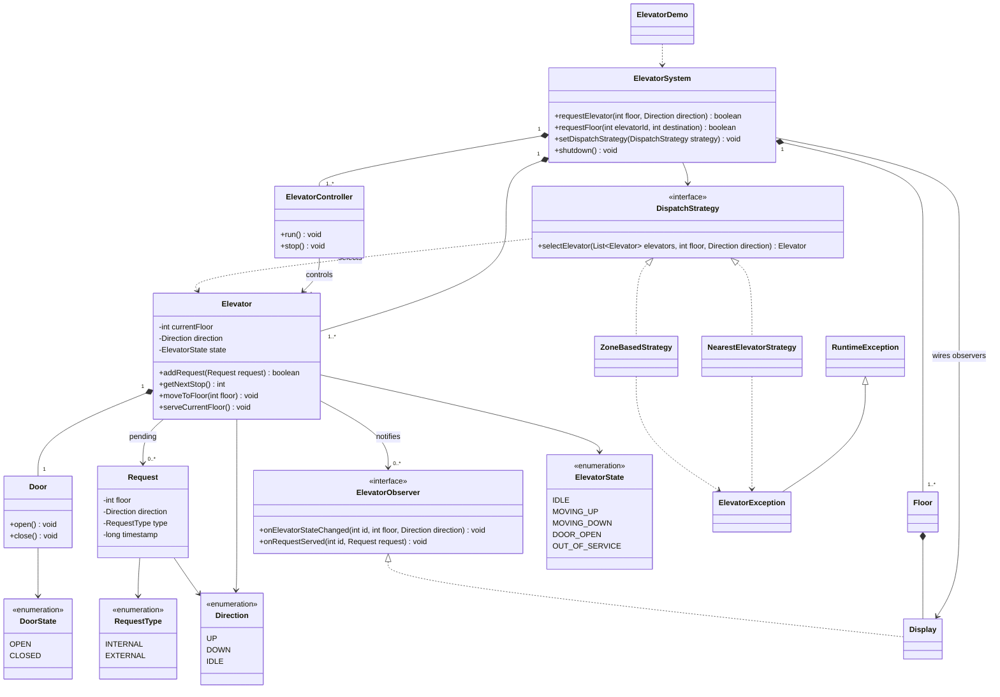

# Elevator System — Low-Level Design

A Java simulation demonstrated with **10 floors and 3 elevators**. Building size is configurable; floor numbers and elevator IDs start at **1**.

## Requirements

### Functional

1. Support configurable floor and elevator counts.
2. Accept internal requests with a destination floor and external requests with a floor and UP/DOWN direction.
3. Support replaceable dispatch strategies, initially nearest-elevator selection.
4. Update cabin and hall displays through observers; elevators do not depend on Display.
5. Run each elevator controller in its own thread.
6. Return `false` for invalid passenger requests or unavailable service. A request for the car's current floor succeeds as a no-op.

### Non-functional

- Separate responsibilities using OOP and SOLID principles.
- Keep dispatch and display behavior extensible through interfaces.
- Synchronize shared car state and hall-button state.
- Support isolated test instances and configurable simulation delays.

## Run

Use **JDK 17+**; the implementation was compiled and tested with your JDK 23. No external dependencies are required.

In IntelliJ, add `Elevator System` as a Java module, mark `src` as **Sources Root**, and run `ElevatorDemo.main()`. Mark `test` as **Test Sources Root** to run `ElevatorSystemTest.main()`. Keep this module separate from other exercises with overlapping package names.

From the `Elevator System` folder in PowerShell:

```powershell
$sources = Get-ChildItem src,test -Recurse -Filter *.java | ForEach-Object FullName
javac -d out $sources
java -cp out ElevatorDemo
java -cp out ElevatorSystemTest
```

## API example

```java
try (ElevatorSystem system = new ElevatorSystem(3, 10)) {
    system.requestElevator(3, Direction.UP);
    system.requestFloor(1, 8);
    system.setDispatchStrategy(new ZoneBasedStrategy(10, 3));
    // Keep the application alive while requests are being processed.
}
```

Closing stops, interrupts and joins all controllers. It cancels pending travel rather than draining requests. The demo waits before closing. Public constructors support independent instances; `getInstance(cars, floors)` remains available for singleton-style usage.

## Classes

| Type | Responsibility |
| --- | --- |
| Direction | UP, DOWN, IDLE |
| ElevatorState | IDLE, MOVING_UP, MOVING_DOWN, DOOR_OPEN, OUT_OF_SERVICE |
| DoorState | OPEN, CLOSED |
| RequestType | INTERNAL, EXTERNAL |
| Request | Immutable floor, direction, origin and timestamp |
| Door | Synchronized door state |
| Elevator | Car position, lifecycle, sorted pending stops and notifications |
| Floor | Hall-button state and a display panel |
| ElevatorObserver | State-change and request-served callbacks |
| Display | Concurrent floor/direction snapshots for one car or all cars |
| DispatchStrategy | Select an elevator for a hall request |
| NearestElevatorStrategy | Prefer approaching same-direction cars, then nearby idle cars, then other available cars |
| ZoneBasedStrategy | Assign contiguous floor zones; fall back to the nearest available car |
| ElevatorController | LOOK scheduling and movement in a dedicated thread |
| ElevatorSystem | Validation, dispatch, observer wiring and lifecycle facade |
| ElevatorDemo | Runnable scenarios |
| ElevatorException | Strategy-level unavailable-service error, converted to false by the facade |

## Scheduling

1. Validate hall requests: reject nonexistent floors, null/IDLE direction, DOWN at floor 1, and UP at the top floor.
2. Dispatch to an available car. Keep the corresponding hall button pressed until pickup; coalesce repeated pending hall calls.
3. Send cabin destinations directly through `requestFloor(elevatorId, destination)`.
4. Store requests by floor in a sorted map, coalescing duplicate type/direction requests.
5. Apply **LOOK**: serve stops ahead, then reverse when none remain ahead. An idle car starts toward the closest pending stop.
6. Move one floor at a time with doors closed and recheck for intermediate requests.
7. At a stop, remove served requests, open doors, notify observers, wait, then close doors. Reset only the hall direction button whose request was served.
8. When idle, wait on the car monitor instead of polling.

**Simulation choice:** hall direction influences dispatch, but an assigned pickup is a floor stop regardless of arrival direction. Passenger destinations are submitted separately as cabin requests. This is LOOK over assigned stops, not a directional passenger-boarding simulation.

## Threading and extension points

- Mutable elevator state is guarded by the car's monitor. Floor-button access is synchronized.
- Displays maintain concurrent snapshots. A cabin panel observes one car; a hall panel observes all cars.
- Movement, direction, door and lifecycle changes trigger notifications; the display contract exposes floor and direction.
- Observer callbacks are synchronous and must be fast and non-blocking. Runtime exceptions from observers are isolated from controllers.
- OUT_OF_SERVICE cars reject new requests and retain pending work until restored to service. Automatic reassignment is not implemented.
- Shutdown closes doors, joins threads and rejects further facade requests. Repeated shutdown calls are safe.
- Implement `DispatchStrategy` to add another hall dispatch algorithm or `ElevatorObserver` for another display.

## Verification

`test/ElevatorSystemTest.java` checks LOOK order and reversal, an UP pickup below the car, invalid input, same-floor no-ops, zone dispatch, hall display updates, button clearing, 100 concurrent cabin requests, unavailable cars, and thread termination. Checks throw `AssertionError` directly; `-ea` is not required.

## Scope

This is an in-memory learning simulation. Capacity limits, overload sensors, fire/emergency modes, persistence, networking, graphical UI, and production safety controls are outside scope. Invalid configuration throws `IllegalArgumentException`; invalid passenger requests return `false`.

## UML class diagram


