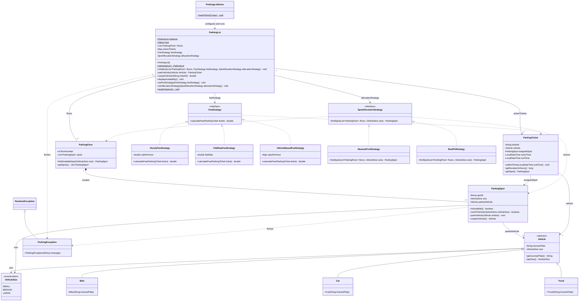

# Parking Lot — Low-Level Design

Requirements and proposed class design for a multilevel parking lot.

Demo entry point: [ParkingLotDemo.java](src/ParkingLotDemo.java).

## Functional Requirements

1. **Multiple floors:** Support a multilevel parking lot. Each floor can have a different number and distribution of parking spots.
2. **Vehicle types:** Support bikes, cars, and trucks.
3. **Entry and exit gates:** Support multiple entry and exit gates.
4. **Spot compatibility:** Assign a spot with a compatible size for the vehicle. Issue a unique parking ticket for every admitted vehicle.
5. **Pricing:** Record both entry and exit times. Calculate parking fees based on the duration of stay.
6. **Unavailable parking:** Reject entry when the lot is full or no compatible spot is available.

## Non-Functional Requirements

1. Follow object-oriented programming and SOLID principles.
2. Keep the design modular and extensible for future requirements.
3. Handle concurrent entry and exit events safely, without race conditions.
4. Make components testable in isolation.

## Core Entities

- ParkingLot
- ParkingFloor
- Vehicle
- ParkingSpot
- EntryGate and ExitGate
- ParkingTicket
- Payment

## Proposed Class Design

These notes describe the intended design, rather than a guarantee that every requirement is implemented.

### Enum: VehicleSize

```java
SMALL
MEDIUM
LARGE
```

### Abstract Class: Vehicle

```text
Fields:
  String licensePlate
  VehicleSize size

Constructor:
  Vehicle(String licensePlate, VehicleSize size)
```

Concrete subclasses: `Bike`, `Car`, and `Truck`.

Subclasses make the code more readable: `new Car("ABC-123")` expresses intent more clearly than `new Vehicle("ABC-123", VehicleSize.MEDIUM)`. Since `Vehicle` is abstract, the latter is only a comparison with an alternative concrete-class design.

### Data Class: ParkingTicket

```text
Fields:
  String ticketId
  Vehicle vehicle
  ParkingSpot parkingSpot
  entryTime
  exitTime

Constructor:
  ParkingTicket(String ticketId, Vehicle vehicle, ParkingSpot assignedSpot)

Methods:
  getDurationInHours(): long
```

### Interface: FeeStrategy

```text
calculateFee(ParkingTicket ticket): double
```

### Interface: SpotAllocationStrategy

```text
findSpot(List<ParkingFloor> floors, VehicleSize size): ParkingSpot
```

### Core Class: ParkingSpot

```text
Fields:
  String spotId
  VehicleSize size
  Vehicle parkedVehicle

Constructor:
  ParkingSpot(String spotId, VehicleSize size)

Methods:
  isAvailable(): boolean
  canFitVehicle(VehicleSize vehicleSize): boolean
  parkVehicle(Vehicle vehicle): void
  unparkVehicle(): Vehicle
```

### Core Class: ParkingFloor

```text
Fields:
  int floorNumber
  List<ParkingSpot> spots

Constructor:
  ParkingFloor(int floorNumber, Map<VehicleSize, Integer> spotCounts)

Methods:
  findAvailableSpot(VehicleSize size): ParkingSpot
```

### Core Class: ParkingLot

```text
Fields:
  ParkingLot instance
  List<ParkingFloor> floors
  Map<String, ParkingTicket> activeTickets
  FeeStrategy feeStrategy
  SpotAllocationStrategy allocationStrategy

Methods:
  getInstance(): ParkingLot
  parkVehicle(Vehicle vehicle): ParkingTicket
  unparkVehicle(String ticketId): double
  displayAvailability()
```

`EntryGate`, `ExitGate`, and `Payment` are identified above; their class details are still to be defined.

## UML Class Diagram

This diagram reflects the current Java classes in `src`. Key fields and methods are shown; routine getters and most constructors are omitted for readability. `EntryGate`, `ExitGate`, and `Payment` are not yet implemented.



**Notation:** `+` means public, `-` means private, and underlined members are static. A hollow triangle represents inheritance; a dashed line with a hollow triangle represents interface implementation. A filled diamond represents composition, a hollow diamond represents aggregation, and an arrow represents a reference or dependency. `0..*` means zero or more, and `0..1` means optional.

**Design patterns:** `ParkingLot` uses Singleton. Fee calculation and spot allocation use Strategy, allowing their implementations to be switched at runtime. `Bike`, `Car`, and `Truck` set their sizes to `SMALL`, `MEDIUM`, and `LARGE`, respectively.
